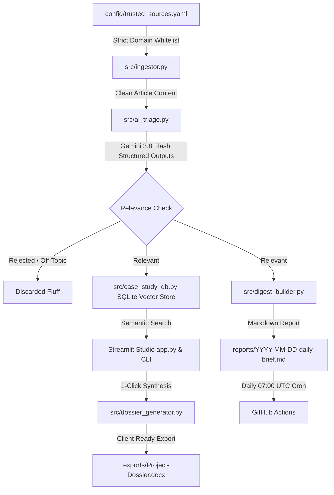

# 🏛️ ArchIntel-Agent
> **Automated, Production-Grade Architectural Intelligence & Design Research Workstation**


%20Dossier-2b579a?logo=microsoft-word)


---

## 🌟 Overview & Architectural Philosophy

**ArchIntel-Agent** is an automated architectural intelligence workstation engineered specifically for architects, spatial designers, and material specifiers.

Unlike naive scrapers that poll generic search engines and collect hallucinated clickbait, ArchIntel-Agent operates on a **Zero-Trust Verification Pipeline**:
1. **Strict Source Whitelisting with Indian & Global Curation:** RSS and structured endpoints are strictly locked in `config/trusted_sources.yaml` to premier architectural publications (*ArchDaily*, *Dezeen*, *Architectural Record*, and verified Indian contexts: *Architectural Digest India*, *ThinkMatter*, *Design Pataki*). Any URL outside the whitelist is automatically rejected by the Python `DomainGuard`.
2. **3-Part AI Triage (`google-genai` + Pydantic):** Articles are classified using `gemini-3.8-flash` into:
   - **`ARCHITECTURAL_NEWS`** (Structural feats, civic/cultural developments, masterplans)
   - **`INTERIOR_NEWS`** (Spatial design, hospitality/residential interiors, lighting, acoustics)
   - **`MATERIAL_LAUNCH_NEWS`** (Engineered surfaces, bio-composites, smart materials, facade tech)
   *Off-topic marketing, fashion, and non-architectural fluff are rejected automatically (`is_relevant = False`).*
3. **Persistent SQLite Dense Vector Knowledge Base:** Articles and extracted metadata (architect, typology, climate/location, materials used, 3-bullet takeaways) are indexed with 3072-dimensional embeddings (`gemini-embedding-001`) in SQLite with zero C++ compilation dependencies.
4. **Client-Ready Case Study Dossier Synthesizer (`src/dossier_generator.py`):** Synthesizes executive design strategies, comparative precedent matrices, material palettes, and strict citations directly into formatted Microsoft Word (`.docx`) documents with clickable links and styling.
5. **Interactive Studio Workstation (`app.py`):** Streamlit dashboard featuring precedent search, multi-category filters, 1-click Word dossier downloads, and a persistent Saved Shortlist bookmarking system.
6. **1-Click Windows Launcher (`Launch_ArchIntel.bat`):** Double-click desktop launcher that auto-activates `.venv` and opens the workstation.

---

## 🏗️ Architecture Diagram



---

## 🚀 Quickstart

### 1. Launch with 1 Click (Windows)
Double-click `Launch_ArchIntel.bat` in the project root to start the Streamlit Studio workstation at `http://localhost:8501`.

### 2. Manual Setup
```bash
# Create virtual environment
python -m venv .venv

# Activate on Windows (PowerShell)
.\.venv\Scripts\Activate.ps1
# Or on Linux/macOS
# source .venv/bin/activate

# Install dependencies
pip install -r requirements.txt
```

### 3. Configure Environment
Copy `.env.example` to `.env`:
```bash
cp .env.example .env
```
Add your free **Gemini API Key** from [Google AI Studio](https://aistudio.google.com/):
```env
GEMINI_API_KEY="your_gemini_api_key_here"
```

### 4. Run the Daily Pipeline
```bash
# Ingest feeds, triage with Gemini, update SQLite vector store, and build the daily markdown report
python main.py
```

### 5. Search Case Studies & Synthesize Dossiers via CLI
```bash
# Search using natural language architectural requirements
python case_study_finder.py "Hospitality project in a humid coastal climate using sustainable timber and perforated brick"

# Or launch interactive mode
python case_study_finder.py --interactive
```

---

## 📁 Repository Structure
```text
├── .github/workflows/daily_arch_digest.yml   # 07:00 UTC daily automated ingestion
├── config/trusted_sources.yaml               # Strict whitelist & verified feed URLs (Global & Indian)
├── data/case_studies_db/                     # Local SQLite persistent vector storage
├── exports/                                  # Generated Word (.docx) & Markdown dossiers
├── reports/                                  # Formatted 3-part daily Markdown briefs
├── src/
│   ├── __init__.py
│   ├── ingestor.py                           # Feed parser, domain guard, HTML stripper
│   ├── ai_triage.py                          # Pydantic schemas & Gemini structured triage
│   ├── case_study_db.py                      # SQLite 3072-d vector indexer & bookmarking
│   ├── digest_builder.py                     # Daily brief generator
│   └── dossier_generator.py                  # Client-ready .docx & .md dossier synthesizer
├── app.py                                    # Streamlit Studio Workstation
├── case_study_finder.py                      # CLI case study search tool
├── Launch_ArchIntel.bat                      # 1-Click Windows desktop launcher
├── main.py                                   # Daily pipeline orchestrator
├── requirements.txt                          # Production dependencies
├── .env.example                              # Secrets configuration template
└── .gitignore                                # Strict secrets & cache exclusion
```

---

## 🛡️ License
MIT License. Built for architectural research and spatial design engineering.
