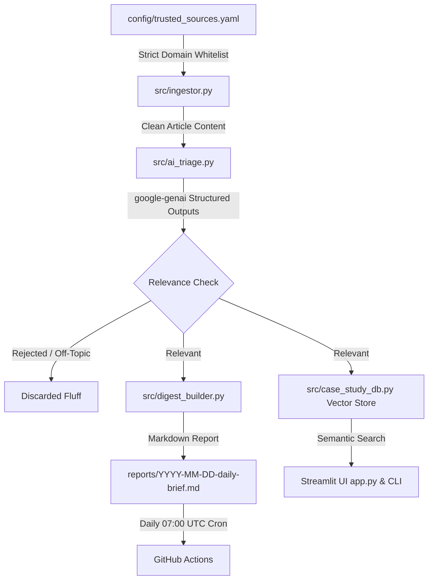

# 🏛️ ArchIntel-Agent
> **Automated, Production-Grade Architectural Intelligence & Case Study Retrieval Engine**


---

## 🌟 Overview & Architectural Philosophy

**ArchIntel-Agent** is an automated AI system engineered specifically for architects, spatial designers, and material specifiers.

Unlike naive scrapers that poll generic search engines and collect hallucinated clickbait, ArchIntel-Agent operates on a **Zero-Trust Verification Pipeline**:
1. **Strict Source Whitelisting:** RSS and structured endpoints are strictly locked in `config/trusted_sources.yaml` to premier architectural publications (*ArchDaily*, *Dezeen*, *Designboom*, *Domus*, *Architectural Record*, *Divisare*, *MaterialDistrict*, *Transmaterial*). Any URL outside the whitelist is automatically rejected by the Python `DomainGuard`.
2. **3-Part AI Triage (`google-genai` + Pydantic):** Articles are classified into:
   - **`ARCHITECTURAL_NEWS`** (Structural feats, civic/cultural developments, masterplans)
   - **`INTERIOR_NEWS`** (Spatial design, hospitality/residential interiors, lighting, acoustics)
   - **`MATERIAL_LAUNCH_NEWS`** (Engineered surfaces, bio-composites, smart materials, facade tech)
   *Off-topic fluff, fashion, and lifestyle marketing are rejected automatically (`is_relevant = False`).*
3. **Persistent Case Study Knowledge Base:** Articles and extracted metadata (architect, typology, climate/location, materials used, 3-bullet takeaways) are indexed locally.
4. **Interactive Retrieval:** Search precedents using natural language design queries (e.g., *"Hospitality project in a humid coastal climate using sustainable timber and perforated brick"*) via the CLI or Streamlit UI.
5. **Daily Digest & Automation:** Daily Markdown reports saved in `reports/YYYY-MM-DD-daily-brief.md` and automated via a scheduled GitHub Action running daily at 07:00 AM UTC.

---

## 🏗️ Architecture Diagram



---

## 🚀 Quickstart

### 1. Clone & Setup Virtual Environment
```bash
python -m venv .venv
.venv\Scripts\Activate.ps1
pip install -r requirements.txt
```

### 2. Configure Environment
Copy `.env.example` to `.env`:
```bash
cp .env.example .env
```
Add your free **Gemini API Key** from [Google AI Studio](https://aistudio.google.com/):
```env
GEMINI_API_KEY="your_gemini_api_key_here"
```

### 3. Run the Daily Pipeline
```bash
python main.py
```

### 4. Search Case Studies via CLI
```bash
python case_study_finder.py "Hospitality project in a humid coastal climate using sustainable timber and perforated brick"
```

### 5. Launch the Streamlit Dashboard
```bash
streamlit run app.py
```
