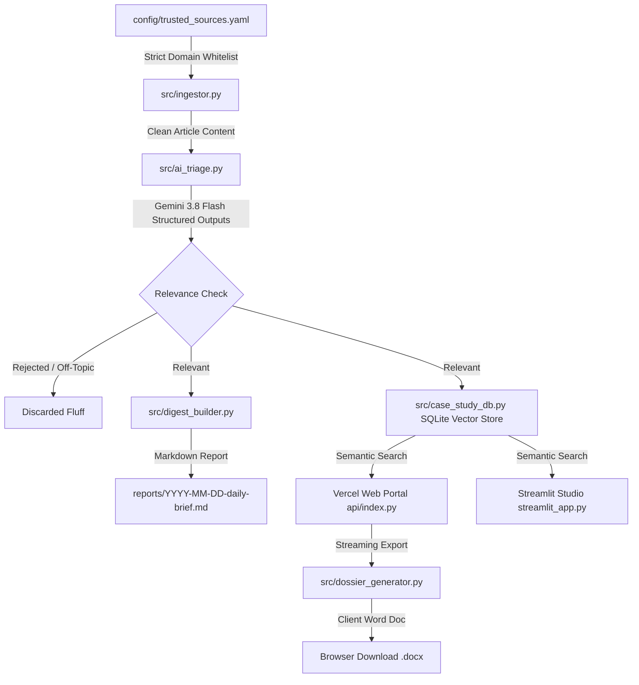

# 🏛️ ArchIntel-Agent
> **Automated Architectural Intelligence, Case Study Retrieval & Vercel Web Workstation**


%20Dossier-2b579a?logo=microsoft-word)


---

## 🌟 Overview & Architectural Philosophy

**ArchIntel-Agent** is an automated architectural intelligence workstation engineered specifically for architects, spatial designers, and material specifiers.

Unlike naive scrapers that poll generic search engines and collect hallucinated clickbait, ArchIntel-Agent operates on a **Zero-Trust Verification Pipeline**:
1. **Strict Source Whitelisting with Indian & Global Curation:** RSS and structured endpoints are strictly locked in `config/trusted_sources.yaml` to premier architectural publications (*ArchDaily*, *Dezeen*, *Architectural Record*, and verified Indian contexts: *Architectural Digest India*, *ThinkMatter*, *Design Pataki*). Any URL outside the whitelist is automatically rejected by the Python `DomainGuard`.
2. **3-Part AI Triage (`google-genai` + Pydantic):** Articles are classified using `gemini-3.8-flash` into:
   - **`ARCHITECTURAL_NEWS`** (Structural feats, civic/cultural developments, masterplans)
   - **`INTERIOR_NEWS`** (Spatial design, hospitality/residential interiors, lighting, acoustics)
   - **`MATERIAL_LAUNCH_NEWS`** (Engineered surfaces, bio-composites, smart materials, facade tech)
   *Off-topic marketing, fashion, and non-architectural fluff are rejected automatically (`is_relevant = False`).*
3. **Dual-Interface Studio Workstation:**
   - **Vercel Serverless Web Portal (`api/index.py`):** High-performance FastAPI backend serving an editorial dark-aesthetic web application (Tailwind CSS, zero-install, in-memory `.docx` streaming).
   - **Local Streamlit Studio (`streamlit_app.py`):** Interactive desktop research engine with 1-click launcher (`Launch_ArchIntel.bat`).
4. **Persistent SQLite 3072-d Vector Knowledge Base:** Articles and extracted metadata are indexed with 3072-dimensional embeddings (`gemini-embedding-001`). On Vercel, the engine auto-seeds from `data/seed_case_studies.json` and uses `/tmp` storage.
5. **Client-Ready Case Study Dossier Synthesizer (`src/dossier_generator.py`):** Synthesizes executive design strategies, comparative precedent matrices, material palettes, and strict citations directly into Microsoft Word (`.docx`) documents streamed straight to the browser.

---

## 🏗️ Architecture Diagram



---

## ☁️ Deploying to Vercel

1. Push this repository to GitHub: `https://github.com/ScorVoid/arch-intel-agent`
2. In the [Vercel Dashboard](https://vercel.com/):
   - Import `ScorVoid/arch-intel-agent`.
   - Add Environment Variable:
     - `GEMINI_API_KEY`: Your Gemini API key from [Google AI Studio](https://aistudio.google.com/).
   - Click **Deploy**.
3. Vercel automatically boots `api/index.py` as an ASGI Serverless Function, serving the full web portal at your production Vercel URL!

---

## 🚀 Local Quickstart

### 1. Launch Streamlit Studio with 1 Click (Windows)
Double-click `Launch_ArchIntel.bat` in the project root to start the Streamlit Studio workstation at `http://localhost:8501`.

### 2. Run Vercel FastAPI Server Locally
```bash
# Run FastAPI local server
uvicorn api.index:app --reload --port 8000
```
Open [http://localhost:8000](http://localhost:8000) in your browser.

### 3. Run the Daily Ingestion Pipeline
```bash
# Ingest feeds, triage with Gemini, and update vector store
python main.py
```

---

## 📁 Repository Structure
```text
├── api/
│   └── index.py                              # Vercel ASGI FastAPI entrypoint & Web UI
├── config/trusted_sources.yaml               # Strict whitelist & verified feed URLs (Global & Indian)
├── data/
│   ├── case_studies_db/                      # Local SQLite persistent vector storage
│   └── seed_case_studies.json                # Pre-populated verified precedent seed dataset
├── exports/                                  # Generated Word (.docx) & Markdown dossiers
├── reports/                                  # Formatted 3-part daily Markdown briefs
├── src/
│   ├── __init__.py
│   ├── ingestor.py                           # Feed parser, domain guard, HTML stripper
│   ├── ai_triage.py                          # Pydantic schemas & Gemini structured triage
│   ├── case_study_db.py                      # SQLite 3072-d vector indexer & bookmarking
│   ├── digest_builder.py                     # Daily brief generator
│   └── dossier_generator.py                  # Client-ready .docx & .md dossier synthesizer
├── Launch_ArchIntel.bat                      # 1-Click Windows desktop launcher
├── main.py                                   # Daily pipeline orchestrator & ASGI export
├── streamlit_app.py                          # Streamlit Studio Workstation
├── vercel.json                               # Vercel serverless routing configuration
├── requirements.txt                          # Production dependencies
├── .env.example                              # Secrets configuration template
└── .gitignore                                # Strict secrets & cache exclusion
```

---

## 🛡️ License
MIT License. Built for architectural research and spatial design engineering.
